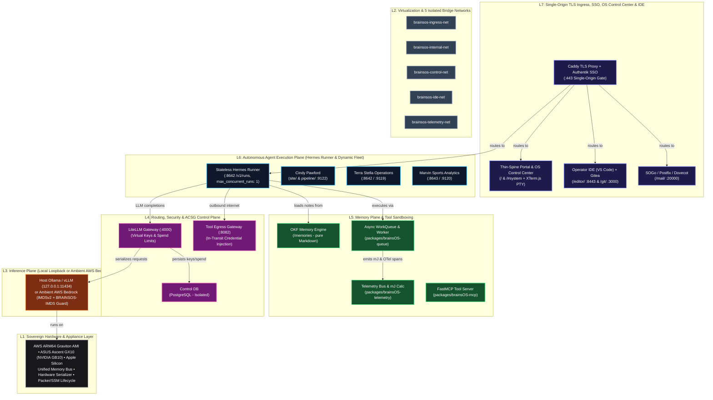

# brainsOS: The Sovereign "Enterprise Agent in a Box" Appliance OS & Governance Runtime

[](https://brainsos.ai)
[](#5-cohumain-acsg-conformance-roadmap--community-pr-drive)
[](#8-appliance-service-directory--deployment-targets)
[](LICENSE)
[](.github/ISSUE_TEMPLATE/cohumain_control.md)

> **Safe, secure, private, and asynchronous. Stop renting multi-tenant SaaS agent black boxes—run your own single-tenant AI appliance in your AWS VPC or on your own bare-metal silicon.**

<div align="center">

**[⚡ Quickstart](#7-quickstart--getting-started)** • **[🗺️ Interactive Architecture](#interactive-html-reference-architecture-blueprints)** • **[🛡️ COHUMAIN Roadmap](#5-cohumain-acsg-conformance-roadmap--community-pr-drive)** • **[📦 Appliances (AWS & Edge)](#8-appliance-service-directory--deployment-targets)** • **[🤝 Contribute](#cohumain-community-pr-drive--how-to-contribute)**

**Website**: [brainsOS.ai](https://brainsos.ai) • **Initiative**: [Patterns at Scale](https://patternsatscale.com) • **Governance Standard**: [COHUMAIN ACSG](docs/cohumain/CONTROLS.md)

</div>

---

**brainsOS** is the open-source operating system and governance runtime for the **Balanced Reasoning & Agent Inference Node System (BRAINS)**—packaging **18 enterprise open-source services** across **5 isolated Docker bridge networks** into a turnkey, single-tenant **"Enterprise Agent in a Box" appliance**.

Whether deployed as a hardened **Ubuntu 24.04 ARM64 (AWS Graviton) Golden AMI** inside your own AWS account (powered by keyless **Amazon Bedrock** over IMDSv2) or run locally on **bare-metal ARM64 silicon** (**ASUS Ascent GX10 / NVIDIA GB10** and **Apple Silicon** workstations with loopback **Ollama / vLLM**), brainsOS gives you total ownership of your agents, memories, source control, network perimeter, and deterministic kill switches.

Governed by physics. Accountable down to the millijoule. Zero SaaS rent.

<details open>
<summary><strong>📑 Table of Contents (10 Core Sections)</strong></summary>

1. [Why a Sovereign Agent Appliance? Own Your Box — In Your AWS VPC or On Your Metal](#1-why-a-sovereign-agent-appliance-own-your-box--in-your-aws-vpc-or-on-your-metal)
   - [Two First-Class Sovereign Deployment Modes](#two-first-class-sovereign-deployment-modes)
   - [Sovereign brainsOS Appliance vs. Cloud-Rentier SaaS Platforms](#sovereign-brainsos-appliance-vs-cloud-rentier-saas-platforms)
   - [The Patterns at Scale Philosophy](#the-patterns-at-scale-philosophy)
2. [Core Architectural Capabilities](#2-core-architectural-capabilities)
3. [Out-of-the-Box Governance Stack (18 Embedded Services)](#3-out-of-the-box-governance-stack-18-embedded-services)
4. [The BRAINS Reference Architecture (L1–L7 Model)](#4-the-brains-reference-architecture-l1l7-model)
   - [Interactive HTML Reference Architecture Blueprints](#interactive-html-reference-architecture-blueprints)
5. [COHUMAIN ACSG Conformance Roadmap & Community PR Drive](#5-cohumain-acsg-conformance-roadmap--community-pr-drive)
   - [Tier 1 (Foundational) Conformance Tracker (8 Controls)](#tier-1-foundational-conformance-tracker-8-controls)
   - [Tier 2 (Managed) Conformance Tracker (+10 Controls, 18 Cumulative)](#tier-2-managed-conformance-tracker-10-controls-18-cumulative)
   - [COHUMAIN Community PR Drive & How to Contribute](#cohumain-community-pr-drive--how-to-contribute)
6. [Connection to Research: Project Millijoule (mJ)](#6-connection-to-research-project-millijoule-mj)
7. [Quickstart & Getting Started](#7-quickstart--getting-started)
   - [Prerequisites](#prerequisites)
   - [Option A: Launch Turnkey AWS ARM64 Appliance AMI](#option-a-launch-turnkey-aws-arm64-appliance-ami)
   - [Option B: Bootstrap on Bare-Metal Edge or Workstation Silicon](#option-b-bootstrap-on-bare-metal-edge-or-workstation-silicon)
8. [Appliance Service Directory & Deployment Targets](#8-appliance-service-directory--deployment-targets)
9. [Common Lifecycle Operations](#9-common-lifecycle-operations)
   - [Email → Agent Run → Reply](#email--agent-run--reply)
10. [Repository Directory Structure, Domain Setup & Governance](#10-repository-directory-structure-domain-setup--governance)
    - [Website-Style Repository & Domain Redirection (`brainsos.ai`)](#website-style-repository--domain-redirection-brainsosai)
    - [Repository Transition Notice](#repository-transition-notice)
    - [License & Governance](#license--governance)

</details>

---

> [!NOTE]
> ### 🚧 Project Status: Active Development (Alpha) & Open Certification Drive
> **brainsOS is an active open-source engineering project under rapid alpha development.**
> 
> The **COHUMAIN Agentic Cybersecurity Governance (ACSG)** controls catalog included in this repository represents our **architectural North Star and conformance roadmap**. While foundational baseline controls (deterministic kill switches, least-privilege host sandboxing, kernel IMDSv2 isolation, in-transit credential injection, and OKF memory purity) are operational today, full certification across **Tier 1 (8 controls)**, **Tier 2 (18 cumulative controls)**, and **Tier 3 (25 controls)** is an open, phased engineering effort. We publish our complete architecture, source code, and control mappings in the open to build transparently and invite [community PRs](#cohumain-community-pr-drive--how-to-contribute).

---

## 1. Why a Sovereign Agent Appliance? Own Your Box — In Your AWS VPC or On Your Metal

Most "agent platforms" force a false choice: either rent seats on a multi-tenant SaaS black box where someone else holds your prompts, memory graph, and API keys—or stitch together fragile local containers with zero network isolation, no SSO, and raw secrets sitting in `.env` files.

**brainsOS** takes a third path: a **hardened, single-tenant "Enterprise Agent in a Box" appliance** that you own end-to-end, engineered to run with 100% ARM64 container parity in your own AWS account or on your own physical hardware.

### Two First-Class Sovereign Deployment Modes

1. **☁️ Sovereign Cloud Appliance (AWS ARM64 Graviton AMI + Ambient Bedrock)**:
   - **Turnkey Golden AMI (`packages/brainsOS-appliance`)**: Pre-built from a clean Git tag via HashiCorp Packer (`make build-ami`) over AWS SSM Session Manager, gated by a fail-closed secret/key scanner and AWS Inspector vulnerability checks.
   - **Keyless Ambient Amazon Bedrock + Kernel IMDS Guard**: LiteLLM routes to **Amazon Bedrock** (Anthropic Claude, Amazon Nova, cross-region inference profiles) using the EC2 Instance Role over **IMDSv2**—**zero LLM API keys stored in `.env`**. Simultaneously, `scripts/setup/imds-guard.sh` enforces the `BRAINSOS-IMDS` `iptables` chain on `169.254.169.254/32`, permitting *only* the LiteLLM container to reach instance metadata and dropping all packets from agent runners and app containers.
   - **First-Boot Identity Wizard & Break-Glass Recovery**: First boot (`firstboot.sh`) generates unique per-instance credentials, binds break-glass `admin`/`akadmin` recovery to the **EC2 Instance ID**, and runs a guided **Superuser Wizard** that provisions your operator identity across **Authentik SSO**, **SOGo Webmail**, **Gitea**, and **LiteLLM** (`proxy_admin`), with built-in Let's Encrypt or keyless Route 53 DNS-01 TLS (`<username>.aws.cloud.brainsos.ai` or custom BYOD domain).
   - **Zero-Inbound-SSH Perimeter Lockdown**: UFW default-deny exposes only `80`/`443` via Caddy TLS. Port `22` is closed; operators manage the host via **AWS SSM** or the built-in browser **OS Control Center (`/#system`)** with an interactive **XTerm.js** host PTY, live APT security patch telemetry, and one-click unattended OS upgrades.
2. **⚡ Bare-Metal Edge & Workstation Appliance (ASUS Ascent GX10 / Apple Silicon / Linux)**:
   - **100% Local Inference & Hardware Serialization**: Runs offline or on-LAN on the **ASUS Ascent GX10** (NVIDIA GB10 Grace Blackwell Superchip, 128 GB unified LPDDR5x @ ~273 GB/s) or **Apple Silicon**, binding **Ollama / vLLM** strictly to host loopback (`127.0.0.1:11434`) while LiteLLM serializes completions (`max_parallel_requests: 1`) to prevent unified memory bus thrashing.
   - **Thermodynamic & Millijoule Accounting**: Tracks physical energy expenditure down to the millijoule (`mJ/tok`) via `packages/brainsOS-telemetry`, scaling reasoning workloads to match local power budgets and thermal limits.

### Sovereign brainsOS Appliance vs. Cloud-Rentier SaaS Platforms

| Capability / Dimension | 🏢 Cloud-Rentier SaaS Agent Platforms | 🛡️ Sovereign brainsOS Appliance (AWS AMI or Bare-Metal) |
|---|---|---|
| **Tenancy & Ownership** | Shared multi-tenant SaaS; per-seat fees, token markups & vendor lock-in | **100% Single-Tenant Appliance** — Run free on local silicon or as a private ARM64 Graviton AMI in your own AWS VPC |
| **Inference & Cloud IAM** | Static API keys pasted into third-party dashboards | **Ambient AWS Bedrock (IMDSv2 + `BRAINSOS-IMDS` iptables guard)** on AWS, or **loopback Ollama/vLLM** on bare metal |
| **Execution Topology** | Fragile synchronous HTTP/WebSocket loops that fail when tabs close | **Asynchronous by design** — Email-triggered (`Postfix`/`SOGo`) + persistent FIFO work queues (`packages/brainsOS-queue`) |
| **Memory & Source Control** | Opaque cloud vector stores and un-audited prompt databases | **Pure OKF Markdown** in `/memories` (`SEC-07`), versioned locally in embedded **Gitea (`/git/`)** + **VS Code (`/editor/`)** |
| **Tool & Egress Secrets** | Raw GitHub PATs and API keys injected into agent runtime containers | **Zero ambient container secrets** — Injected in transit by `brainsos-agent-egress-proxy:8082` (`SEC-02`) |
| **Perimeter & Host Access** | Public multi-tenant endpoints; no host-level inspection | **Single-origin TLS (`:443`) + Authentik SSO**; port 22 closed; browser **OS Control Center (`/#system`)** with XTerm.js PTY |
| **Runaway Containment** | Soft billing alerts after spend thresholds are already breached | **Deterministic Kill Switch (`SAF-02`)** — `make emergency-stop` halts containers and revokes virtual keys in `<5s` |
| **Governance & Auditability** | Proprietary black-box logs | **COHUMAIN ACSG 25-Control Anchor** + self-hosted **Langfuse v4** OpenTelemetry tracing (ClickHouse/Redis/MinIO) |

### The Patterns at Scale Philosophy
Rooted in the *Patterns at Scale Manifesto*, brainsOS enforces a physical computing paradigm:

* **Computation Must Learn to Breathe with the Grid**: Scaling up when energy generation and ambient conditions afford it, scaling down when physical constraints demand it.
* **Energy Quotas Rather than Just Token Budgets**: Tying execution limits directly to battery reserves, solar generation curves, and ambient thermal saturation.
* **Accounting for Every Watt Down to the Millijoule**: Moving beyond theoretical model parameter counts to measure total thermodynamic cost per completed task.
* **Living with System Heat**: Treating compute as a responsive micro-utility, recycling thermal exhaust when possible, and curbing demands when the environment requires it.

---

## 2. Core Architectural Capabilities

```
┌────────────────────────────────────────────────────────┐
│                PROJECT MILLIJOULE (mJ)                 │
│    The Overarching Mission & Thermodynamic Research    │
│ (Solar orchestration, thermal sinks, waste heat reuse) │
├────────────────────────────────────────────────────────┤
│                         BRAINS                         │
│    Balanced Reasoning & Agent Inference Node System    │
│ (brainsOS.ai: ACSG governance runtime & kill switches) │
├────────────────────────────────────────────────────────┤
│                 PHYSICAL & SENSORY LAYER               │
│  AWS Graviton / GX10 GB10 • Microgrid Bus • Sensors    │
└────────────────────────────────────────────────────────┘
```

### 1. Asynchronous Message & Queue Execution
Replaces unpredictable synchronous agent loops with a decoupled queuing harness (`packages/brainsOS-queue`). Reasoning steps, tool executions, and multi-agent communications flow through strict asynchronous message brokers, enforcing backpressure, concurrency limits, and energy-aware job scheduling.

### 2. Deterministic Safety Circuit Breakers & Kill Switches
Translates ACSG agent safety into hard physical boundaries. If an autonomous agent diverges or enters an unconstrained loop, brainsOS drains or drops queue workers, cutting execution deterministically via `./scripts/control/emergency-stop.sh` or virtual key invalidation before cloud budgets spike, battery reserves collapse, or silicon reaches thermal limits.

### 3. Least-Privilege Host Sandboxing & Kernel IMDS Isolation
Enforces strict boundary isolation on both bare-metal silicon and AWS EC2. Agent runtimes drop elevated Linux capabilities (`cap_drop: [ALL]`), operate under non-root identities (`PUID=1000`, `PGID=1000`), block exposure of `/var/run/docker.sock`, and are blocked at the Linux kernel `iptables` layer (`BRAINSOS-IMDS`) from reaching EC2 instance metadata (`169.254.169.254/32`).

### 4. Memory Plane Purity (Open Knowledge Format) & Local Git Versioning
Runtimes are ephemeral and disposable. Long-term agent knowledge is preserved exclusively in human-auditable flat-file Markdown notes using the Open Knowledge Format (OKF) via `packages/brainsOS-memory` and versioned in the appliance's embedded **Gitea** server (`operator/agent-box`). Binary indices, SQLite databases, and packages are strictly forbidden in `/memories` and reside in `/workspace`.

### 5. Dynamic Capabilities MCP Server (Zero Native Tool Injection)
Exposes agent tools across all domain packages dynamically via the Model Context Protocol (FastMCP) over `stdio` (`packages/brainsOS-mcp`). Eliminates prompt bloat and KV cache exhaustion on unified memory architectures by avoiding direct injection of custom tool definitions into native Hermes system prompts.

---

## 3. Out-of-the-Box Governance Stack (18 Embedded Services)

brainsOS unifies 18 enterprise-grade open-source components into a single, pre-wired appliance across 5 isolated bridge networks:

| Component | Role in brainsOS Appliance | Governance & Security Boundary |
|---|---|---|
| **Thin-Spine Portal & OS Control Center** | Unified full-bleed workspace (`/`) + appliance administration (`/#system`) | Built-in First-Boot Superuser Wizard, interactive **XTerm.js** host PTY, APT security patch manager, runner/tool key manager, and universal update/rollback. |
| **[Authentik](https://goauthentik.io) & [Caddy](https://caddyserver.com)** | Single-origin TLS (`:443`) reverse proxy & Zero-Trust Forward-Auth IdP | Enforces single sign-on across every appliance UI; supports internal Root CA, Let's Encrypt HTTP-01, and keyless Route 53 DNS-01 ACME. |
| **[LiteLLM](https://github.com/BerriAI/litellm)** | Token governance, virtual quotas, model routing, and fallback pathways | Serializes requests (`max_parallel_requests: 1`) for unified memory buses; routes to **Ambient AWS Bedrock (IMDSv2)** or loopback **Ollama/vLLM**. |
| **IMDSv2 Firewall (`imds-guard.sh`)** | Kernel-level EC2 metadata isolation (`packages/brainsOS-appliance`) | `DOCKER-USER` → `BRAINSOS-IMDS` `iptables` chain allows only LiteLLM to reach `169.254.169.254/32` and drops all agent/app containers. |
| **[Langfuse v4](https://langfuse.com)** | Distributed OpenTelemetry tracing (backed by ClickHouse, Redis, MinIO, Postgres) | Unified thread-level tracing across email runs, Hermes turns, tool spans, token latency, and error states. |
| **In-Transit Egress Proxy ([mitmproxy](https://mitmproxy.org))** | Outbound L7 firewall & multi-tenant credential injection (`:8081`/`:8082`) | Containers hold **zero ambient secrets**; proxy injects GitHub/API credentials in transit by container IP and masks tokens in `mitmweb` logs. |
| **[Postfix](https://www.postfix.org), [Dovecot](https://www.dovecot.org) & [SOGo](https://sogo.nu)** | Decoupled, auditable asynchronous email & CalDAV groupware backbone | Every inbound email triggers one checkpointed Hermes run and returns one reply—eliminating fragile synchronous polling loops. |
| **Operator IDE ([code-server](https://github.com/coder/code-server))** | Browser-based VS Code workspace (`/editor/`) behind Authentik SSO | Pre-wired to `/data` (`operator/agent-box`) for inspecting and editing agent personas, skills, and OKF memories. |
| **Source Control ([Gitea](https://about.gitea.com))** | Embedded self-hosted Git server (`/git/`) with Authentik reverse-proxy SSO | Automatically seeded with `operator/agent-box` (`main` & `initial-setup` branches) to version `/data` prompts, `SOUL.md` personas, and memories locally. |

---

## 4. The BRAINS Reference Architecture (L1–L7 Model)

### Interactive HTML Reference Architecture Blueprints

Explore the complete appliance architecture, 5 isolated Docker bridge networks, and 18 embedded services in our self-contained, zero-dependency interactive HTML engineering blueprints located in [`docs/`](docs/):

| Interactive Blueprint | Views & Engineering Schematics Included | Launch / Inspect |
|---|---|---|
| **1. [Appliance Reference Architecture & Network Topology](docs/brainsos-reference-architecture.html)**<br/>*(`docs/brainsos-reference-architecture.html`)* | **5-Tab Keynote & Audit Deck**:<br/>• `01` **SVG-Wired Network Topology**: Animated, filterable live traffic flows across `ingress-net`, `internal-net`, `control-net`, `ide-net`, `telemetry-net` & host loopback<br/>• `02` **Clean Reference Blueprint**: L1–L7 security zones & appliance perimeter<br/>• `03` **Embedded Product Stack (18)**: Deep-dive wiring cards for every service<br/>• `04` **Zero-Trust Reachability Matrix**: Interactive container-to-container allow/mediate/block firewall grid<br/>• `05` **Storage & Silicon Physics**: Two-Repository Architecture, Gitea `/data` tracking & LPDDR5x serialization | **[🌐 Launch Interactive Deck in Browser](https://htmlpreview.github.io/?https://github.com/patternsatscale/brainsOS.ai/blob/main/docs/brainsos-reference-architecture.html)**<br/>• [View HTML Source in Repo](docs/brainsos-reference-architecture.html) |
| **2. [Enterprise Network Bus & NIC Matrix Schematics](docs/brainsos-network-architecture-diagram.html)**<br/>*(`docs/brainsos-network-architecture-diagram.html`)* | **3-Mode Orthogonal Vector Schematics**:<br/>• `01` **Reference Architecture Schematic**: Enterprise "AI in a Box" security zones & orthogonal data paths<br/>• `02` **Network Bus & NIC Matrix Diagram**: L2/L3 switch-fabric & container virtual NIC attachment matrix across all 5 bridge subnets + loopback<br/>• `03` **Side-by-Side / Print Both**: Poster & architecture review mode | **[🌐 Launch Network Schematic in Browser](https://htmlpreview.github.io/?https://github.com/patternsatscale/brainsOS.ai/blob/main/docs/brainsos-network-architecture-diagram.html)**<br/>• [View HTML Source in Repo](docs/brainsos-network-architecture-diagram.html) |



``` text
┌─────────────────────────────────────────────────────────────────────────────┐
│ L7: Communications, UX, OS Control Center & Operator IDE                    │
│     - Single-Origin TLS Ingress: Caddy (:80/:443) + Authentik Forward-Auth  │
│     - Thin-Spine Portal & OS Control Center: / & /#system (XTerm.js PTY)    │
│     - Messaging Daemons: brainsos-app-signal-cli, Postfix SMTP, SOGo        │
│     - Operator IDE & SCM: VS Code (/editor/ :8443) + Gitea (/git/ :3000)    │
├─────────────────────────────────────────────────────────────────────────────┤
│ L6: Agent Execution Plane (Warm Stateless Hermes Runner & Dynamic Profiles) │
│     - Shared Hermes Runner (:8642 async API /v1/runs, max_concurrent_runs:1)│
│     - Dynamic Manifest Registry: config/agents.yaml (Zero Container Drift)  │
│     - Asynchronous Agent Core SPI: packages/brainsOS-agent                  │
│     - Agent-Centric Storage: data/agents/<tenant>/ (SOUL, memories, work)   │
├─────────────────────────────────────────────────────────────────────────────┤
│ L5: Memory Plane & Tool Sandbox                                             │
│     - Standalone Packages: packages/brainsOS-memory/, brainsOS-queue/, etc. │
│     - Telemetry & Energy Accounting: packages/brainsOS-telemetry/           │
│     - Agent-Centric Partitions: ./data/agents/<id>/ (SOUL, memories, ws)    │
│     - Local Git Versioning: Gitea operator/agent-box tracks /data state     │
├─────────────────────────────────────────────────────────────────────────────┤
│ L4: Routing, Security & ACSG Control Plane                                  │
│     - LiteLLM Gateway (:4000) with dynamic virtual keys & spend limits      │
│     - Hardware Serialization: max_parallel_requests: 1 (LPDDR5x guard)      │
│     - Tool Egress Proxy: brainsos-agent-egress-proxy (:8081/8082, flows & auth)│
│     - Control Plane DB: brainsos-control-litellm-db (PostgreSQL, isolated)  │
├─────────────────────────────────────────────────────────────────────────────┤
│ L3: Inference Plane (Dual Sovereign Modes)                                  │
│     - Bare-Metal Mode: Host Ollama / vLLM bound to loopback (127.0.0.1:11434)│
│     - AWS Appliance Mode: Ambient Amazon Bedrock via EC2 IMDSv2 IAM Role    │
│     - Kernel Guard: BRAINSOS-IMDS iptables blocks all non-LiteLLM containers│
├─────────────────────────────────────────────────────────────────────────────┤
│ L2: Virtualization & 5 Isolated Bridge Networks                             │
│     - brainsos-ingress-net (Caddy -> Service ports & Authentik SSO gates)   │
│     - brainsos-internal-net (Agent execution, messaging & egress proxy)     │
│     - brainsos-control-net (Strictly isolates control plane DB from agents) │
│     - brainsos-ide-net (Isolates Operator VS Code IDE & Gitea SCM)          │
│     - brainsos-telemetry-net (Langfuse v4, ClickHouse, Redis, MinIO bus)    │
├─────────────────────────────────────────────────────────────────────────────┤
│ L1: Hardware, Cloud Appliance & Physical Plane                              │
│     - AWS Cloud Appliance: Ubuntu 24.04 ARM64 Graviton Golden AMI (Packer)  │
│     - Bare-Metal Target: ASUS Ascent GX10 (NVIDIA GB10 ARM64, unified memory)│
│     - Development Workstation: Apple Silicon macOS (native ARM64 parity)    │
│     - Microgrid & Power Bus: DC shunts, Battery Management, Solar telemetry │
├─────────────────────────────────────────────────────────────────────────────┤
│ Cross-Cutting: Observability & Operational Safety                           │
│     - Decoupled Langfuse v4 + OpenTelemetry distributed thread tracing      │
│     - Universal update engine & rollback (make update / backup.sh)          │
│     - Granular emergency kill-switch (make emergency-stop)                  │
└─────────────────────────────────────────────────────────────────────────────┘
```

---

## 5. COHUMAIN ACSG Conformance Roadmap & Community PR Drive

brainsOS is engineered as the open-source reference harness for **COHUMAIN certification**, operationalizing the 25-control **Agentic Governance & Security Controls (AGSC v1.0.0)** standard developed jointly by **[COHUMAIN Labs](https://www.cohumain.ai/research)** (responsible-AI research) and **[SafeAlign AI](https://safealignai.io/)** (enterprise agent governance and security).

The complete, canonical 25-control catalog and regulatory crosswalks (EU AI Act, NIST AI RMF, ISO 42001, MITRE ATLAS, MITRE ATT&CK, MIT AI Risk) are maintained directly in [`docs/cohumain/`](docs/cohumain/) under [CC BY 4.0](docs/cohumain/LICENSE). See [`docs/cohumain/conformance.md`](docs/cohumain/conformance.md) for the graduated conformance tiers.

### Tier 1 (Foundational) Conformance Tracker (8 Controls)

**Tier 1 (Foundational)** is the minimum bar for any production autonomous agent—covering core safety, autonomy boundaries, least-privilege identity, and observability that prevent the highest-severity, fastest-moving failures:

| Control ID | Pillar | Control Name & Specification | Status | brainsOS Implementation Plane & Verification Evidence |
|---|---|---|---|---|
| **[`SAF-01`](docs/cohumain/CONTROLS.md#saf-01-autonomous-system-oversight)** | 🛡️ Safety | [Autonomous System Oversight](docs/cohumain/CONTROLS.md#saf-01-autonomous-system-oversight) | 🟡 In Progress | Langfuse v4 OpenTelemetry distributed traces (`packages/brainsOS-telemetry`) & unified email thread traces. *Seeking PRs: automated `≥5` deviation threshold alerting.* |
| **[`SAF-02`](docs/cohumain/CONTROLS.md#saf-02-emergency-stop--containment-kill-switch)** | 🛡️ Safety | [Emergency Stop & Containment (Kill Switch)](docs/cohumain/CONTROLS.md#saf-02-emergency-stop--containment-kill-switch) | 🟢 Operational | Single-command halt (`make emergency-stop` / `./scripts/control/emergency-stop.sh`), `/v1/runs/{id}/stop` cancellation, and LiteLLM virtual key revocation. |
| **[`SAF-03`](docs/cohumain/CONTROLS.md#saf-03-content-safety--misuse-prevention)** | 🛡️ Safety | [Content Safety & Misuse Prevention](docs/cohumain/CONTROLS.md#saf-03-content-safety--misuse-prevention) | ⚪ Seeking PRs | *Seeking PRs (`cohumain:tier1`): inline input/output safety guardrails in `config/litellm/` (or Bedrock Guardrails) and pre-deployment jailbreak test suite.* |
| **[`ALN-01`](docs/cohumain/CONTROLS.md#aln-01-autonomy-boundary-control)** | 🎯 Alignment | [Autonomy Boundary Control](docs/cohumain/CONTROLS.md#aln-01-autonomy-boundary-control) | 🟢 Operational | Declarative agent action space (`config/default_settings/agents.yaml`), scoped FastMCP tools (`packages/brainsOS-mcp`), and serialized runs (`max_concurrent_runs: 1`). |
| **[`ALN-02`](docs/cohumain/CONTROLS.md#aln-02-human-oversight--intervention)** | 🎯 Alignment | [Human Oversight & Intervention](docs/cohumain/CONTROLS.md#aln-02-human-oversight--intervention) | 🟡 In Progress | Asynchronous email-first human review (`Postfix`/`SOGo`), Operator IDE (`code-server`), and Gitea PR workflow. *Seeking PRs: high-impact tool approval gates.* |
| **[`SEC-02`](docs/cohumain/CONTROLS.md#sec-02-agent-identity--least-privilege-authorization)** | 🔒 Security | [Agent Identity & Least-Privilege Authorization](docs/cohumain/CONTROLS.md#sec-02-agent-identity--least-privilege-authorization) | 🟢 Operational | Per-tenant virtual keys, unprivileged sandboxes (`PUID=1000`, `cap_drop: [ALL]`), `BRAINSOS-IMDS` kernel guard (`imds-guard.sh`), and IP-pinned in-transit token injection (`verify-egress-token-injection.sh`). |
| **[`SEC-03`](docs/cohumain/CONTROLS.md#sec-03-prompt-injection--adversarial-input-defense)** | 🔒 Security | [Prompt Injection & Adversarial Input Defense](docs/cohumain/CONTROLS.md#sec-03-prompt-injection--adversarial-input-defense) | 🟡 In Progress | Egress proxy boundary filtering (`:8082`) and sub-agent code/output sanitization. *Seeking PRs: inbound email & context prompt-injection classifiers.* |
| **[`SEC-04`](docs/cohumain/CONTROLS.md#sec-04-observability-anomaly-detection--incident-response)** | 🔒 Security | [Observability, Anomaly Detection & Incident Response](docs/cohumain/CONTROLS.md#sec-04-observability-anomaly-detection--incident-response) | 🟡 In Progress | Per-call Langfuse v4 OTel spans and `mitmweb` egress flow inspection (`:8081`). *Seeking PRs: automated behavioral anomaly rules and IR drill scripts.* |

### Tier 2 (Managed) Conformance Tracker (+10 Controls, 18 Cumulative)

**Tier 2 (Managed)** adds governance, provenance, multi-agent coordination security, memory lifecycle protection, and proactive red-teaming—appropriate for material or customer-facing autonomous systems (requires all 8 Tier 1 controls plus the 10 controls below):

| Control ID | Pillar | Control Name & Specification | Status | brainsOS Implementation Plane & Verification Evidence |
|---|---|---|---|---|
| **[`SAF-04`](docs/cohumain/CONTROLS.md#saf-04-output-factual-accuracy--anti-hallucination)** | 🛡️ Safety | [Output Factual Accuracy & Anti-Hallucination](docs/cohumain/CONTROLS.md#saf-04-output-factual-accuracy--anti-hallucination) | ⚪ Seeking PRs | *Seeking PRs (`cohumain:tier2`): groundedness benchmarks and automated OKF source citation verification for agent outputs.* |
| **[`SAF-05`](docs/cohumain/CONTROLS.md#saf-05-ai-output-monitoring--safeguards)** | 🛡️ Safety | [AI Output Monitoring & Safeguards](docs/cohumain/CONTROLS.md#saf-05-ai-output-monitoring--safeguards) | ⚪ Seeking PRs | *Seeking PRs (`cohumain:tier2`): runtime output drift/harm monitors and human-gate triggers prior to external action.* |
| **[`ALN-05`](docs/cohumain/CONTROLS.md#aln-05-output-labeling--action-attribution)** | 🎯 Alignment | [Output Labeling & Action Attribution](docs/cohumain/CONTROLS.md#aln-05-output-labeling--action-attribution) | 🟢 Operational | Mandatory agent attribution headers, `Co-authored-by` Git trailers, and tenant-scoped email/commit identity (`AGENTS.md`). |
| **[`GOV-01`](docs/cohumain/CONTROLS.md#gov-01-data-provenance--input-integrity)** | ⚖️ Governance | [Data Provenance & Input Integrity](docs/cohumain/CONTROLS.md#gov-01-data-provenance--input-integrity) | 🟡 In Progress | Git-backed OKF Markdown memory lineage (`./scripts/control/snapshot-memories.sh`) and embedded Gitea (`operator/agent-box`) versioning. *Seeking PRs: cryptographic input integrity checks.* |
| **[`GOV-02`](docs/cohumain/CONTROLS.md#gov-02-ai-change-governance)** | ⚖️ Governance | [AI Change Governance](docs/cohumain/CONTROLS.md#gov-02-ai-change-governance) | 🟢 Operational | Declarative manifests (`agents.yaml`), versioned `SOUL.md` personas in Gitea, universal rollback (`make update`), fail-closed AMI staging (`make build-ami`), and CI pre-commit gates. |
| **[`GOV-05`](docs/cohumain/CONTROLS.md#gov-05-model-evaluation)** | ⚖️ Governance | [Model Evaluation](docs/cohumain/CONTROLS.md#gov-05-model-evaluation) | ⚪ Seeking PRs | *Seeking PRs (`cohumain:tier2`): pre-deployment model evaluation harness (quality, robustness, and latency/mJ benchmarks across Ollama & Bedrock routes).* |
| **[`SEC-01`](docs/cohumain/CONTROLS.md#sec-01-multi-agent-coordination-security)** | 🔒 Security | [Multi-Agent Coordination Security](docs/cohumain/CONTROLS.md#sec-01-multi-agent-coordination-security) | 🟢 Operational | Decoupled supervisor/sub-agent personas (`brainsos_agent.souls.resolve_soul`), cross-tenant storage isolation, and queue-mediated messaging (`./scripts/verify/verify-fleet.sh`). |
| **[`SEC-05`](docs/cohumain/CONTROLS.md#sec-05-ai-threat-modeling)** | 🔒 Security | [AI Threat Modeling](docs/cohumain/CONTROLS.md#sec-05-ai-threat-modeling) | 🟢 Operational | L1–L7 architectural threat model ([`SECURITY.md`](SECURITY.md), [`docs/reference-architecture-tenets.md`](docs/reference-architecture-tenets.md), [`docs/brainsos-reference-architecture.html`](docs/brainsos-reference-architecture.html)) mapped to MITRE ATLAS & ATT&CK. |
| **[`SEC-06`](docs/cohumain/CONTROLS.md#sec-06-ai-security-testing--red-teaming)** | 🔒 Security | [AI Security Testing & Red-Teaming](docs/cohumain/CONTROLS.md#sec-06-ai-security-testing--red-teaming) | ⚪ Seeking PRs | *Seeking PRs (`cohumain:tier2`): automated adversarial red-teaming and prompt-injection regression harness under `scripts/verify/`.* |
| **[`SEC-07`](docs/cohumain/CONTROLS.md#sec-07-memory--context-lifecycle-security)** | 🔒 Security | [Memory & Context Lifecycle Security](docs/cohumain/CONTROLS.md#sec-07-memory--context-lifecycle-security) | 🟢 Operational | Strict OKF Markdown memory purity engine (`packages/brainsOS-memory`, `./scripts/verify/verify-memories.sh`) rejecting binaries, DBs, and caches from `/memories`. |

> **Tier 3 (Assured — 25 Total Controls)**: Adds `ALN-03` ([Decision Interpretability](docs/cohumain/CONTROLS.md#aln-03-decision-interpretability)), `ALN-04` ([Model Explainability](docs/cohumain/CONTROLS.md#aln-04-model-explainability)), `GOV-03` ([Third-Party & Supply-Chain Oversight](docs/cohumain/CONTROLS.md#gov-03-third-party--supply-chain-oversight)), `GOV-04` ([Model Training Governance](docs/cohumain/CONTROLS.md#gov-04-model-training-governance)), `GOV-06` ([Model Continuous Improvement & Drift Management](docs/cohumain/CONTROLS.md#gov-06-model-continuous-improvement--drift-management)), `GOV-07` ([AI Lifecycle & Registry Management](docs/cohumain/CONTROLS.md#gov-07-ai-lifecycle--registry-management)), and `GOV-08` ([Environmental & Carbon Governance](docs/cohumain/CONTROLS.md#gov-08-environmental--carbon-governance) — active in `packages/brainsOS-telemetry`).

### COHUMAIN Community PR Drive & How to Contribute

We are running an open community engineering drive to reach **100% automated verification across Tier 1 (8 controls) and Tier 2 (18 cumulative controls)**. Every control in brainsOS is backed by real code, declarative config, and an idempotent verification script in `scripts/verify/`.

1. **Pick a Control (`🟡 In Progress` or `⚪ Seeking PRs`)**:
   - Browse open issues filtered by community contribution labels:
     - `cohumain:tier1` — Foundational safety, boundary, and security controls (`SAF-01`..`03`, `ALN-01`..`02`, `SEC-02`..`04`).
     - `cohumain:tier2` — Managed governance, evaluation, and red-team controls (`SAF-04`..`05`, `ALN-05`, `GOV-01`..`02`, `GOV-05`, `SEC-01`, `SEC-05`..`07`).
     - `good-first-issue` — Self-contained verification scripts (`scripts/verify/verify-*.sh`), pytest suites, or LiteLLM/mitmproxy rules ideal for new contributors.
2. **Open or Claim a Control Issue**:
   - Use our dedicated **[COHUMAIN Control Implementation & Verification Issue Template](.github/ISSUE_TEMPLATE/cohumain_control.md)** to specify the Control ID, threat mitigated, BRAINS L1–L7 implementation plane, and audit evidence.
3. **Build & Verify with Script-First Discipline**:
   - Follow [`CONTRIBUTING.md`](CONTRIBUTING.md) and [`AGENTS.md`](AGENTS.md): codify checks in `scripts/verify/` or `packages/`, run `make test && make lint`, and submit a Pull Request referencing the control ID (e.g., `[#123] feat(governance): implement SAF-03 LiteLLM content safety guardrails`).

---

## 6. Connection to Research: Project Millijoule (mJ)

**brainsOS** is the general-purpose, open-source platform that powers **Project Millijoule (mJ)**, an overarching research initiative and living laboratory operated by Patterns at Scale.

While brainsOS provides the open-source software harness, Project mJ investigates the outer physical boundaries of environment-aware computation:
* **Power-Adaptive Reasoning**: Dynamically scaling reasoning depth and model parameter sizes against real-time solar generation curves and battery state-of-charge.
* **Heat-Aware Compute Scheduling (Digital Boilers)**: Treating processors as responsive thermal micro-utilities, batching background reasoning to supplement living-space heating during cold hours.
* **Thermal Characterization Lab**: First-law open-loop flow calorimetry measuring empirical heat dissipation against electrical draw to calculate the true millijoules expended per generated token (`mJ/tok`).

> [!NOTE]
> **Data Demarcation**: Project mJ's living-space sensory feeds, continuous-flow calorimetry logs, proprietary agent personas, and private memory trees remain unshared. brainsOS is the reusable open-source tooling.

---

## 7. Quickstart & Getting Started

### Prerequisites

| Component | Minimum Requirement | Recommended / Notes |
|---|---|---|
| **Operating System** | Ubuntu 24.04 LTS ARM64 (AWS Graviton / DGX OS) or macOS 14+ (Apple Silicon) | Debian 12+ / Ubuntu 24.04 x86_64 or ARM64 compatible |
| **Container Engine** | Docker Engine 24.0+ & Docker Compose v2 (`docker compose`) | Pre-installed & pre-baked on the AWS Golden AMI |
| **Host Tooling** | `bash` 4+, `curl`, `git`, `jq`, `python3` (3.10+), `python3-venv` | Handled automatically by `setup-host.sh` / AMI `provision.sh` |
| **Unified Memory / Instance** | 16 GB RAM minimum (`t4g.2xlarge` / `m7g.2xlarge` on AWS) | 128 GB Unified LPDDR5x (ASUS Ascent GX10 GB10) or Apple Silicon |
| **Inference Engine** | Ambient AWS Bedrock (via EC2 IAM Role) or Local Ollama / vLLM | NVIDIA CUDA 12+ & `nvidia-container-toolkit` for local GPU acceleration |

---

### Option A: Launch Turnkey AWS ARM64 Appliance AMI

To run brainsOS as a hardened, single-tenant cloud appliance in your own AWS VPC (see [`packages/brainsOS-appliance/README.md`](packages/brainsOS-appliance/README.md) for full details):

1. **Attach the Least-Privilege Instance Role**:
   Launch our Ubuntu 24.04 ARM64 Golden AMI (or build your own via `make build-ami ARGS="--ref v0.5.1"` for a clean-room baseline, or `make build-ami ARGS="--incremental --ref v0.5.1"` for ~5 min delta builds) with an EC2 IAM Instance Profile attached to [`packages/brainsOS-appliance/iam/instance-policy.json`](packages/brainsOS-appliance/iam/instance-policy.json) (grants keyless **Amazon Bedrock** invoke + **AWS SSM Session Manager** with zero inbound SSH port `22`).
2. **First-Boot Identity Wizard & Break-Glass Login**:
   - Open `https://<public-ip-or-dns>/` in your browser.
   - Sign in with the break-glass `admin` account using your **EC2 Instance ID** (`i-0123456789abcdef0`) as the initial password.
   - Complete the **First-Boot Identity Wizard** to set your Appliance Unit Name, external domain/FQDN (e.g., `<username>.aws.cloud.brainsos.ai`), and provision your named **Superuser** across Authentik SSO, SOGo Webmail, Gitea (`/git/`), and LiteLLM.
3. **Optional — Dynamic Fleet DNS via EC2 User Data (`30+` Instances, Zero Elastic IPs) or Post-Boot BYOD**:
   ```ini
   # Supply in EC2 Launch Template / Instance User Data (auto-updates Route 53 A record on every boot/reboot/resume
   # and streamlines the First-Boot Wizard to Superuser + Unit Name setup while preserving Let's Encrypt SSL):
   BRAINSOS_DOMAIN=alice.demo.myorg.com
   BRAINSOS_ROUTE53_ZONE_ID=Z0123456789ABCDEFG
   ```
   ```bash
   # Or configure interactively post-boot via AWS SSM Session Manager / browser XTerm.js PTY (/#system):
   make set-domain ARGS="--domain brainsos.myorg.com --email ops@myorg.com --dns route53"
   ```

---

### Option B: Bootstrap on Bare-Metal Edge or Workstation Silicon

#### 1. Clone the Repository & Configure Environment
```bash
git clone https://github.com/patternsatscale/brainsOS.git
cd brainsOS

# Bootstrap environment: copies .env, creates data directories, installs virtualenv & packages
make setup

# Generate cryptographically secure passwords, configure domains/URLs, and reload services
make env

# Display all service URLs, credentials, and automatically synchronize /etc/hosts
make urls
```

##### Decoupled Private Fleet Mode (Two-Repository Architecture)
By default, runtime data resides locally in `./data` (and is automatically tracked by the embedded **Gitea** `operator/agent-box` repository on appliances). To keep proprietary agent intellectual property, OKF memories, custom personas, and fleet manifests in an external private Git repository:
1. Clone or initialize your private fleet repo (e.g., at `/path/to/my-fleet-repo` using template `config/templates/data-repo.gitignore`).
2. Set `BRAINSOS_DATA_DIR=/path/to/my-fleet-repo` in `.env`.
3. Container volumes, Python core packages, and scripts will automatically bind to your private repository. Run `./scripts/control/snapshot-memories.sh` to take automated Git snapshots and push them directly to your private remote.

#### 2. Run Host Baseline Setup
Execute the idempotent setup script to audit system permissions, install dependencies, configure native loopback inference (Ollama), and seed the default model:
```bash
./scripts/setup/setup-host.sh --pull-model
```

#### 3. Initialize Memory Plane & Build Agent Sandbox
Provision the pure Open Knowledge Format (OKF) storage directories and build the unprivileged agent sandbox:
```bash
./scripts/setup/setup-memories.sh
./scripts/setup/setup-hermes.sh
```

#### 4. Start Host Control Plane
Launch the host-side inference runtime (`ollama` on `127.0.0.1:11434`), LiteLLM proxy gateway (`:4000`), and dynamic PostgreSQL persistence:
```bash
./scripts/control/start-control-plane.sh start
./scripts/control/start-control-plane.sh status
```

#### 5. Launch Appliance Container Cluster
Start the ingress proxy, database, Operator IDE, Gitea, messaging daemons, and agent containers via Docker Compose:
```bash
make up
# or
docker compose up -d
docker compose ps
```

#### 6. Configure Network & Local Domain Routing (`/etc/hosts`)
Route appliance domains to loopback (or your appliance's static LAN IP):
```bash
sudo ./scripts/setup/setup-network.sh --skip-ip -y
```
*Or manually append to `/etc/hosts`:*
```text
127.0.0.1 brainsos.local terrastella.brainsos.local api.terrastella.brainsos.local marvin.brainsos.local api.marvin.brainsos.local cindypawford.brainsos.local api.cindypawford.brainsos.local proxy.brainsos.local memory.brainsos.local langfuse.brainsos.local editor.brainsos.local code.brainsos.local
```

#### 7. Run Verification Test Harnesses & Quality Gates
Validate system isolation, memory purity, package test suites, and routing:
```bash
# Run full package test suites (pytest)
make test

# Run static analysis and type checks (ruff & mypy)
make lint

# Verify multi-agent fleet manifest, isolation, and scheduling
./scripts/verify/verify-fleet.sh

# Verify primary agent workspace persistence and LiteLLM mediation
./scripts/verify/verify-hermes.sh

# Verify Operator IDE and OKF memory plane synchronization
./scripts/verify/verify-editor.sh
./scripts/verify/verify-memories.sh

# Verify in-transit edge egress credential injection
./scripts/verify/verify-egress-token-injection.sh
```

---

## 8. Appliance Service Directory & Deployment Targets

### Supported Sovereign Hardware & Cloud Appliance Profiles
* **Turnkey AWS ARM64 Cloud Appliance (`packages/brainsOS-appliance`)**: **Ubuntu 24.04 LTS on AWS Graviton** (`t4g` / `m7g` / `c7g`), pre-baked via HashiCorp Packer over SSM (`make build-ami`), with **Ambient Amazon Bedrock** via IMDSv2, `BRAINSOS-IMDS` kernel container isolation, single-origin TLS port `443` lockdown, First-Boot Superuser Wizard, and OS Control Center.
* **Bare-Metal Edge Appliance (Production Reference)**: **ASUS Ascent GX10** powered by the **NVIDIA GB10 Grace Blackwell Superchip** (ARM64, 128 GB coherent unified LPDDR5x memory @ ~273 GB/s, DGX OS / Ubuntu 24.04) running local loopback Ollama / vLLM.
* **Local Developer Workstation**: **Apple Silicon macOS** (M1–M4 Max/Ultra) or **Linux ARM64/x86_64**, providing 100% native container parity.

### Appliance Service Endpoints

Once running, all appliance services are unified behind single-origin HTTPS (`:443`) and Authentik SSO:

| Service | Ingress URL | Internal Port | Auth / Access | Role |
|---|---|---|---|---|
| **Thin-Spine Portal** | [https://local.brainsos.ai/](https://local.brainsos.ai/) | `80` / `443` | *Public / SSO* | Bespoke Thin-Spine React shell (<4% rail, 96%+ full-bleed viewport) |
| **OS Control Center** | [https://local.brainsos.ai/#system](https://local.brainsos.ai/#system) | `8000` | Authentik SSO | Superuser Wizard, XTerm.js Host PTY, APT patching, Runner & Tool Keys, Updates |
| **Authentik SSO Ingress** | [https://local.brainsos.ai/auth/](https://local.brainsos.ai/auth/) | `9000` | Superuser / `admin` (`EC2 ID`) | Centralized Zero-Trust SSO & Forward-Auth identity gateway |
| **Operator IDE (VS Code)** | [https://local.brainsos.ai/editor/](https://local.brainsos.ai/editor/) | `8443` | Authentik SSO (`CODE_SERVER_AUTH=none`) | Containerized VS Code (`code-server`) pre-wired to `/data` Git repo |
| **Gitea Source Control** | [https://local.brainsos.ai/git/](https://local.brainsos.ai/git/) | `3000` | Authentik SSO (Reverse-Proxy Auth) | Self-hosted Git server tracking `operator/agent-box` (`SOUL.md`, skills, memories) |
| **SOGo Webmail & Groupware** | [https://local.brainsos.ai/mail/](https://local.brainsos.ai/mail/) | `20000` | Authentik SSO (Trusted Proxy) | Webmail, agent mailboxes & CalDAV calendars |
| **LiteLLM Control Plane** | [https://local.brainsos.ai/proxy/ui](https://local.brainsos.ai/proxy/ui) | `4000` | Authentik SSO (Injected Key) | Hardware-serialized routing (Ollama / Ambient Bedrock), budgets & virtual keys |
| **Tool Egress Proxy Console** | [https://local.brainsos.ai/efw/](https://local.brainsos.ai/efw/) | `8081` | Authentik SSO | Mitmweb real-time egress flow inspection & secret masking |
| **Langfuse Observability** | [https://langfuse.local.brainsos.ai/](https://langfuse.local.brainsos.ai/) | `3001` | Authentik SSO | Distributed OpenTelemetry thread tracing & prompt token breakdown |
| **Hermes Runner WebUI** | [https://local.brainsos.ai/runner/](https://local.brainsos.ai/runner/) | `8787` | Authentik SSO | Multi-tenant stateless agent runner terminal & burn target |
| **Agent Queue & System API** | `http://127.0.0.1:8000` | `8000` | *Internal Gateway* | Non-blocking email webhook ingestion, queue worker & host system API |

---

## 9. Common Lifecycle Operations

```bash
# Standardized lifecycle commands via root Makefile
make setup          # Bootstrap .env, data dirs, venv, and editable packages
make update         # Universal platform update (git sync, container pull, migrations & rollback)
make update-check   # Check current versions vs latest upstream releases (LiteLLM, Langfuse, Git)
make prune-logs     # Automated log rotation, journal vacuuming & disk retention maintenance
make ssl-wildcard   # Configure public wildcard SSL via Route 53 & SST Ion (*.local.<zone>)
make deploy-infra   # Deploy platform cloud infrastructure via SST Ion (Route 53, ACME IAM, SES)
make env            # Generate .env with secure passwords, configure URLs, and rebuild
make reload_env     # Reload .env, synchronize passwords across DBs/containers, and show URLs
make urls           # Display all service URLs & credentials, and synchronize /etc/hosts
make up             # Synchronize fleet manifest and start Docker fleet
make down           # Gracefully stop all Docker services
make test           # Run pytest suite across all packages
make lint           # Run ruff check and mypy across all packages
make langfuse       # Start Langfuse v4 distributed observability stack
make langfuse-status# Check Langfuse health, container status, and OTel ingestion
make emergency-stop # Instantly terminate all agent containers

# Fleet snapshots & backups
./scripts/control/snapshot-memories.sh # Automated Git commit/push of private fleet repo

# Appliance Ingress Lockdown & Host Perimeter Security (Ticket #312 / #332)
docker compose -f docker-compose.yml -f docker/compose/compose.appliance.yml up -d # Single-origin port 443 lockdown
sudo ./packages/brainsOS-appliance/scripts/harden-host.sh # Enforce UFW firewall, SSH hardening, and Docker log constraints
sudo ./scripts/setup/imds-guard.sh --check       # Verify EC2 IMDSv2 container isolation (LiteLLM allowed, all other containers dropped)
./scripts/verify/verify-appliance-ingress.sh  # Verify published ports and Caddy TLS invariants
./scripts/verify/verify-ami-coldboot.sh       # Verify cold-boot provisioning, Superuser wizard & Gitea integration
make build-ami ARGS="--ref v0.1.1 --dry-run" # Stage clean artifact from a git tag + fail-closed scan, print Packer command (#313/#322)
make build-ami ARGS="--ref v0.1.1"          # Build a PRIVATE ARM64 golden AMI (Packer over SSM Session Manager)
make build-ami ARGS="--promote ami-..."     # After rehearsal: Block Public Access pre-flight, then make public
# Instance role policy: packages/brainsOS-appliance/iam/instance-policy.json (see package README)
./scripts/control/backup.sh                  # Compressed tarball backup of all data planes

# Inspect runtime services & logs
./scripts/control/start-control-plane.sh status
docker compose ps
docker compose logs -f caddy
docker compose logs -f hermes-runner

# Email -> run -> reply pipeline (#295)
./scripts/setup/apply-hermes-guards.sh          # Enforce Hermes max_concurrent_runs: 1 + session plugin; recreate runner
./scripts/setup/apply-hermes-guards.sh --check  # Verify only
./scripts/control/purge-agent-mail.sh --yes     # Clean slate: empty agent mailboxes, spool & queue (worker must be stopped)
```

### Email → Agent Run → Reply

Every inbound email to an agent triggers **one** asynchronous Hermes run and produces **one** reply:

1. The queue worker submits `POST /v1/runs` (persona + OKF rules as `instructions`, OKF thread turns as `conversation_history`, canonical `session_id = mail-<agent>-<thread>`, `Idempotency-Key = Message-ID`) and checkpoints the `run_id` on the queue task.
2. It polls `GET /v1/runs/{run_id}` with no socket held open, so runs may last hours. A wall-clock budget (`HERMES_RUN_MAX_SEC`, default 4h) calls `/stop`. A worker restart resumes polling the same run instead of resubmitting.
3. `completed` → the result is emailed and the turn is recorded in OKF. `failed` / `cancelled` / `interrupted` / timeout → the sender gets a plain failure email with recommendations; raw errors go to logs and Langfuse only.
4. Concurrency is 1 at both layers: Hermes `max_concurrent_runs: 1` (the worker backs off on 429) and LiteLLM `max_parallel_requests: 1`.
5. **Unified Langfuse Tracing**: Each email thread produces a single cohesive thread trace in Langfuse (`thread_trace_id(session_id) = sha256(f"{sid}::{sid}")[:16]`) named after the brainsOS event (`brainsos: email: <subject>`). The queue worker records an `email-run <agent_id>` span via OTLP (`/api/public/otel/v1/traces`, `x-langfuse-ingestion-version: 4`) with the sender as `user.id`, timing, and status directly onto the thread trace. Hermes' `observability/langfuse` plugin records the `Hermes turn` (LLM generations, tool calls) under this event trace. Hermes requests to LiteLLM send `no-log: true` via the `brainsos-litellm-session` plugin so LiteLLM avoids duplicating Hermes LLM calls, while LiteLLM's `langfuse_otel` callback directly traces non-Hermes callers (IDE / operator).

---

## 10. Repository Directory Structure, Domain Setup & Governance

``` text
brainsOS/  
├── Makefile                  # Standardized lifecycle commands (setup, up, down, test, lint)
├── pyproject.toml            # Centralized Python tooling configuration (ruff, mypy, pytest)
├── LICENSE                   # Apache License 2.0
├── NOTICE                    # Copyright and third-party attribution notices
├── SECURITY.md               # Responsible vulnerability disclosure policy & threat model
├── REPO_MAP.md               # Navigation map & rules of engagement for contributors
├── CONTRIBUTING.md           # Developer guidelines and verification discipline
├── CODE_OF_CONDUCT.md        # Contributor Covenant v2.1
├── SUPPORT.md                # Community support and contact directory
├── README.md                 # System vision, architecture, and quickstart guide
├── AGENTS.md                 # Agent operating discipline and safety rules
├── docker-compose.yml        # Declarative service topology and isolated networks
├── .env.example              # Environment variables template
├── .github/
│   ├── ISSUE_TEMPLATE/       # Structured issue templates (including cohumain_control.md)
│   └── workflows/            # CI/CD verification and security boundary gates
├── config/  
│   ├── default_settings/     # Declarative fleet and runner manifests (agents.yaml)
│   ├── default_runners/      # Runner templates (hermes, claude-sdk, openai-sdk)
│   ├── default_souls/        # Centralized baseline agent personas (bawtford, marvin, terrastella, ping)
│   ├── templates/            # Seed templates for private data repos (data-repo.gitignore)
│   ├── sample_agent_app/     # Sample agent web application templates (cindypawford)
│   ├── caddy/                # Ingress reverse proxy configuration
│   ├── editor/               # Operator IDE workspace and Continue configs
│   ├── litellm/              # Rate-limiting, model aliases, Bedrock & DB settings
│   └── egress/               # In-transit credential injection proxy rules
├── packages/
│   ├── brainsOS-agent/       # Standalone AgentRuntime SPI & dynamic profile registry
│   ├── brainsOS-appliance/   # Turnkey AWS Graviton AMI builder (Packer/SSM), host hardening & IMDS guard
│   ├── brainsOS-runner/      # Stateless runner adapter framework & agent registry
│   ├── brainsOS-memory/      # Standalone OKF memory engine & VectorStore SPI
│   ├── brainsOS-mail/        # Standalone RFC-compliant asynchronous email client
│   ├── brainsOS-mcp/         # Dynamic FastMCP server exposing tools across packages
│   ├── brainsOS-queue/       # Modular asynchronous FIFO work queue manager
│   ├── brainsOS-skills/      # Hierarchical agent skills loader, validator & CLI
│   └── brainsOS-telemetry/   # Decoupled Observer/Observable bus, System API & SyntheticEnergyObserver
├── docker/                   # Dockerfiles and modular Compose topologies
│   └── compose/              # Modular Compose v2 files by plane (ingress, agents, control, apps, telemetry, appliance)
├── docs/  
│   ├── brainsos-reference-architecture.html        # Interactive 5-tab "Enterprise Agent in a Box" keynote & audit blueprint
│   ├── brainsos-network-architecture-diagram.html  # Orthogonal L2/L3 network switch-fabric & NIC attachment schematics
│   ├── cohumain/             # COHUMAIN ACSG 25-control catalog & conformance roadmap
│   ├── website-repo-setup.md # Domain redirection (brainsos.ai), Open Graph & repo styling guide
│   ├── project-titan/        # Historical ticket & walkthrough archive (September 2026)
│   └── reference-architecture-tenets.md  # Core security tenets (TN-1 to TN-9)
├── data/                     # Partitioned host volumes / private fleet repo (via BRAINSOS_DATA_DIR)
└── scripts/                  # Structured operational scripts
    ├── setup/                # Host, container, memory, network, and IMDS guard provisioning
    ├── control/              # Runtime lifecycle, AMI builds, updates, fleet sync, and kill-switch
    ├── verify/               # Automated test harnesses and verification suites
    └── apps/                 # Application-specific operations tooling
```

### Website-Style Repository & Domain Redirection (`brainsos.ai`)

`brainsos.ai` and `www.brainsos.ai` point directly to this GitHub repository as a unified, zero-bloat developer landing page and documentation hub. Full operational instructions are maintained in **[`docs/website-repo-setup.md`](docs/website-repo-setup.md)**:

* **Cloudflare Edge Redirection (`HTTP 301`)**: Proxied (`🟠`) root `@` (`A 192.0.2.1` / `AAAA 100::`) and `www` (`CNAME brainsos.ai`) records paired with a Cloudflare Single Redirect Rule matching `(http.host eq "brainsos.ai" or http.host eq "www.brainsos.ai")` → `https://github.com/patternsatscale/brainsOS.ai` (`301 Permanent Redirect`).
* **GitHub About & Topic Metadata**:
  * **About**: *Sovereign "Enterprise Agent in a Box" appliance OS & COHUMAIN governance runtime. Run in your own AWS VPC (Graviton AMI + Ambient Bedrock) or on bare-metal silicon.*
  * **Topics**: `agentic-ai`, `ai-governance`, `ai-safety`, `cohumain`, `sovereign-ai`, `edge-ai`, `aws-graviton`, `aws-bedrock`, `arm64`, `dgx-os`, `apple-silicon`, `litellm`, `langfuse`, `mcp`.
* **Social Open Graph Card**: `1280 × 640 px` banner (`80 px` safe inset, `#0f172a` slate background) featuring the brainsOS wordmark, sovereign appliance tagline, and COHUMAIN / AWS Graviton + Bare-Metal / Zero-Trust badges.
* **GitHub Discussions Categories**: `📢 Announcements`, `🛡️ COHUMAIN Controls & PRs`, `⚡ Edge & AWS Appliance Hardware`, and `🚀 Showcase`.

### Repository Transition Notice

This repository has completed its architectural transition to **`patternsatscale/brainsOS`** ([brainsOS.ai](https://brainsos.ai)).

For existing local clones, update your Git remote URL:
```bash
git remote set-url origin https://github.com/patternsatscale/brainsOS.git
git fetch origin
```

All legacy compatibility shims, dual fallbacks, and deprecated naming have been permanently removed in favor of canonical brainsOS configurations and container runtimes.

### License & Governance
* **brainsOS Platform Code**: Licensed under the **[Apache License, Version 2.0](LICENSE)**. Developed by **[Patterns at Scale](https://patternsatscale.com)**.
* **Agentic Governance & Security Controls (AGSC v1.0.0)**: Authored by **[COHUMAIN Labs](https://www.cohumain.ai/research)** and **[SafeAlign AI](https://safealignai.io/)**. Licensed under **[Creative Commons Attribution 4.0 International (CC BY 4.0)](docs/cohumain/LICENSE)** © 2026 COHUMAIN Labs & SafeAlign AI. Official standard documentation and workbook: [himjoe.github.io](https://himjoe.github.io/Agentic-governance-and-security-controls-by-COHUMAIN-Labs-and-Safealign-AI/).
